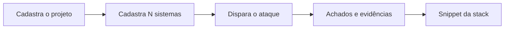

# Shingeki

Plataforma para detecção automatizada e remediação interativa de vulnerabilidades web.

## Por onde começar

| Passo | Guia |
|-------|------|
| 1. Rodar API, client e Docker | [Como rodar o projeto](RUN-PROJECT.md) |
| 2. Entender o monorepo | [Arquitetura](ARCHITECTURE.md) |
| 3. Desenvolver o client web | [Clientes](CLIENTS.md) |
| 4. Consultar rotas HTTP | [API REST](API.md) |
| 5. Lint e testes antes do PR | [CI](ci/overview.md) |

## O que é o Shingeki

O operador cadastra um projeto e, dentro dele, quantos sistemas quiser. Cada sistema tem URL alvo, repositório e stack. O disparo usa o catálogo de ataques daquele sistema. O worker devolve achados. A remediação devolve um snippet da stack do sistema, que a pessoa copia.

- **API Laravel** (`apps/api`) — REST com Sanctum; GraphQL (Lighthouse) só na sidebar; dispatch DAST/SAST com aceite, resultados, probes, remediação e PR no GitHub.
- **Workers** — DAST (Go) e SAST (Semgrep) via RabbitMQ.
- **Client web** — Next.js com BFF (cookie http-only) e Apollo na navegação.

Diagrama dos pacotes: [Arquitetura](ARCHITECTURE.md).

Repositório: [github.com/AllanCordova/shingeki](https://github.com/AllanCordova/shingeki).

## Fontes de verdade

A documentação canônica vive em `docs/` (este site). Cada tópico tem **um** arquivo dono; os demais só apontam para ele — não reescreva o mesmo procedimento, contrato ou lista de credenciais em outro lugar.

| Tópico | Fonte única |
|--------|-------------|
| Como subir o monorepo | [RUN-PROJECT.md](RUN-PROJECT.md) |
| Deploy para testes (client, API e workers) | [DEPLOY.md](DEPLOY.md) |
| Visão do monorepo e fluxo DAST | [ARCHITECTURE.md](ARCHITECTURE.md) |
| Desenho de cada pacote | [architecture/](ARCHITECTURE.md) |
| Índice de rotas HTTP | [API.md](API.md) |
| Contrato HTTP de um módulo | `docs/api/<módulo>.md` |
| Papéis (`USER` / `SPECIALIST` / `ADMIN`) | [AUTHENTICATION.md](api/AUTHENTICATION.md) |
| Aceite de responsabilidade no dispatch | [ATTACK-ACKNOWLEDGMENT.md](api/ATTACK-ACKNOWLEDGMENT.md) |
| Sessão capturada do navegador (DAST autenticado) | [TARGET-SESSION.md](api/TARGET-SESSION.md) |
| Gabarito DAST (fixtures in-process) | [shingeki-dast-goldset.md](architecture/shingeki-dast-goldset.md) |
| Como validar workers | [RUN-PROJECT.md](RUN-PROJECT.md#validar-os-workers) |
| Jobs do CI | [ci/overview.md](ci/overview.md) |

O que **não** compete com estes guias:

- READMEs em `apps/` e `workers/` — ponteiros para `docs/`.
- `AGENT/` — regras para o agente de código; não entra no MkDocs.
- README da raiz — cartão de visita do repositório; aponta para cá.

## Limites atuais

- O seed cria o projeto Laboratório com quatro alvos públicos feitos para scanner: OWASP Juice Shop, Google Firing Range, Acunetix ASP.NET e Gin and Juice. Ataque só esses, ou um sistema que você tem autorização para testar.
- O noVNC da captura não entra no Caddy. A porta 6080 fica em `127.0.0.1`, e cada sessão recebe uma senha que só o dono da captura vê.
- `login_url` tem de ser o mesmo host do `target_url`, ou um subdomínio dele. Host de metadata, link-local e nome de serviço do Docker são recusados.
- Só existe um navegador de captura aberto por vez.
- A remediação por IA exige `GEMINI_API_KEY` ou `GROQ_API_KEY`. Sem chave, o catálogo ainda devolve o snippet literal da stack.
- O SAST clona `repository_url`. Repositório privado precisa de `GITHUB_TOKEN`.
