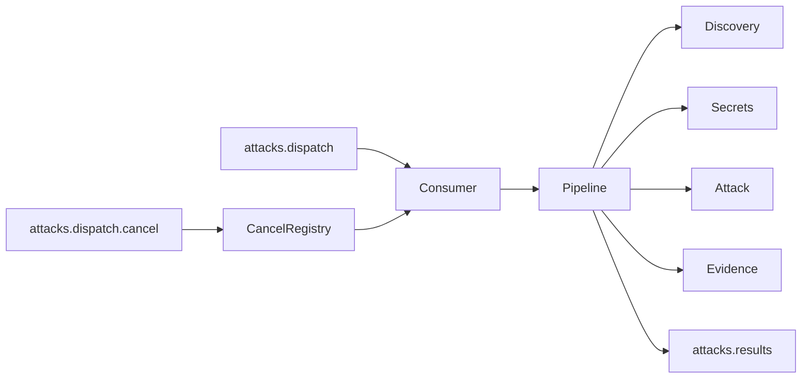

# Auditoria do DAST worker

Documentação do código em `workers/dast` (módulo `github.com/shingeki/dast-worker`). O resumo de arquitetura publicado no site continua em [`docs/architecture/shingeki-dast-worker.md`](../../../docs/architecture/shingeki-dast-worker.md). Esta pasta descreve o que o código faz hoje.

| Documento | Conteúdo |
|-----------|----------|
| [estrutura.md](estrutura.md) | Árvore de pastas e o papel de cada pacote |
| [filas.md](filas.md) | Interface do worker: filas, eventos e `route_map` |
| [pipeline.md](pipeline.md) | Orquestração de um disparo |
| [discovery.md](discovery.md) | Como a superfície do alvo vira vetores |
| [ataque.md](ataque.md) | Jobs, injeção e pool HTTP |
| [evidencia.md](evidencia.md) | Validadores e a ordem em que confirmam um achado |
| [funcoes.md](funcoes.md) | Catálogo das funções de produção, arquivo por arquivo |

## O que este processo é

Binário `cmd/worker`. Não abre porta HTTP. Consome um lote DAST no RabbitMQ, descobre superfície no `target_url`, executa os payloads que a API enfileirou, confirma evidência e publica probes, achados e o fechamento do disparo.

O segundo binário, `cmd/harness`, sobe um alvo in-process (`httptest`) e roda o gabarito `internal/goldset`. Não participa do worker em produção.

## Achados da auditoria

Estes pontos divergem da leitura óbvia do `.env.example` ou do resumo de arquitetura.

1. **O consumer dá ack mesmo quando o pipeline falha.** `handleDelivery` registra o erro e confirma a mensagem. A falha volta para a API só no evento `attack.dispatch.completed` com `status: failed`. Mensagem inválida recebe `Nack` sem requeue e é descartada.
2. **`ATTACK_MAX_JOBS` só existe no ambiente.** Sem a variável, o pool não corta a lista de jobs. O `.env.example` define `5000`.
3. **`route_map` substitui o crawl.** Se o lote traz rotas, o worker não abre Chromium e não mistura rotas gravadas na sessão. O mapa tem teto de 200 entradas.
4. **Ataque de `HEADER` casa com qualquer vetor.** `locationCompatible` devolve verdadeiro para `HEADER` sem olhar o local do vetor. Categoria desconhecida no injector cai em query string.
5. **`depth: quick` desliga o Rod** mesmo com `DISCOVERY_ROD_ENABLED=true`, limita páginas/cliques/forms e, sem `max_routes`, corta a lista em 20 vetores.
6. **Um processo trata um lote por vez** (`RABBITMQ_PREFETCH=1`). Dentro do lote, o pool HTTP é paralelo (`WORKER_ATTACK_CONCURRENCY`). O timeout do job (padrão 3h) precisa ficar abaixo do `consumer_timeout` do broker (4h no compose). O default de Rod no `Load` continua `false`; a imagem e o `.env.example` ligam o Chromium.
